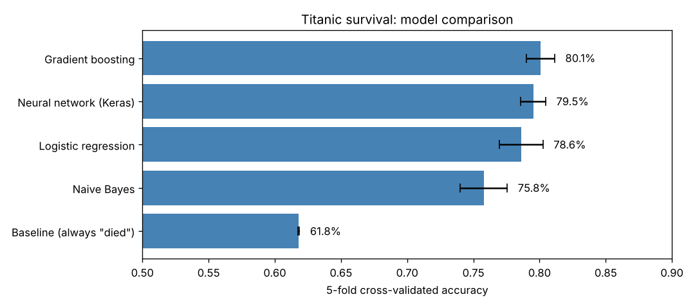
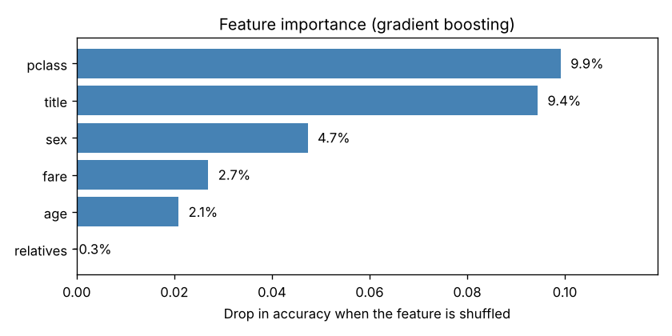
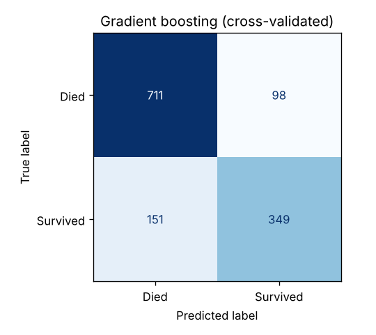

# Titanic Survival Prediction

Predicting which Titanic passengers survived from six features (sex, passenger class, age, whether they travelled with family, fare, and the title in their name), using the `titanic3` dataset of 1,309 passengers.



## Results (5-fold cross-validated accuracy)

| Model | Accuracy | Spread across folds |
|---|---|---|
| Gradient boosting | 81.0% | ±0.9 |
| Logistic regression | 79.8% | ±2.1 |
| Neural network (Keras, 5-5-1) | 79.3% | ±1.8 |
| Naive Bayes | 77.0% | ±2.0 |
| Baseline (always predict "died") | 61.8% | — |

Every model beats the no-skill baseline by a wide margin. Gradient boosting comes out ahead, but the top three are within about 2 points of each other.

## What drives the predictions



- **Passenger class and title matter most.** Title (Mr, Mrs, Miss, Master) separates boys from adult men: "Master" passengers survived at 51%, adult men at 16%. Adding it improved accuracy by about a point.
- **Sex ranks third** only because title already captures most of the same information.
- **Family aboard adds almost nothing** once the other features are known.

## Where the model goes wrong



The model leans toward predicting "died": it catches 88% of passengers who died but only 70% of survivors. It is most reliable for first- and second-class women and for second- and third-class men. Most mistakes are on third-class women and first-class men, whose outcomes were close to a coin flip.

## What's in the notebook

1. **Check and explore:** a data-quality profile with [dstoolkit](https://github.com/Dito-84/dstoolkit), my data-cleaning package, then survival by age, family aboard, class and fare, split by sex (`Titanic Graphs.png`). The profile flags the 20% of missing ages and the mostly-empty columns. Ages are then filled inside each cross-validation fold rather than up front, so test data never leaks into training.
2. **Prepare:** encode sex, add a `relatives` flag, extract title from the name, and fill missing ages with the median inside the model pipeline (about 20% of passengers have no recorded age; they're kept rather than dropped)
3. **Compare:** score each model on the same five stratified folds so the comparison doesn't depend on one train/test split
4. **Explain:** cross-validated confusion matrix, error rates by class and sex, and permutation feature importance

## Run it

```bash
pip install -r requirements.txt
pip install -r requirements-optional.txt   # optional: the data-quality check
jupyter notebook titanic_survival.ipynb
```

`dstoolkit` is only used for the data-quality check. Without it, that one cell is skipped and everything else runs the same.

## Data

`titanic3.csv` from the Vanderbilt Biostatistics Titanic dataset. Missing values are recorded as `?` and converted to `NaN` on load.

## License

The code and notebook are [MIT](LICENSE)-licensed. `titanic3.csv` isn't covered: it keeps the terms of its source, the Vanderbilt Biostatistics Titanic dataset.
